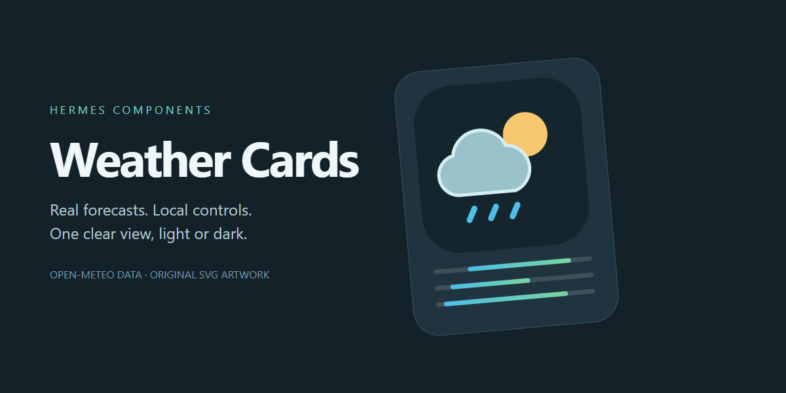
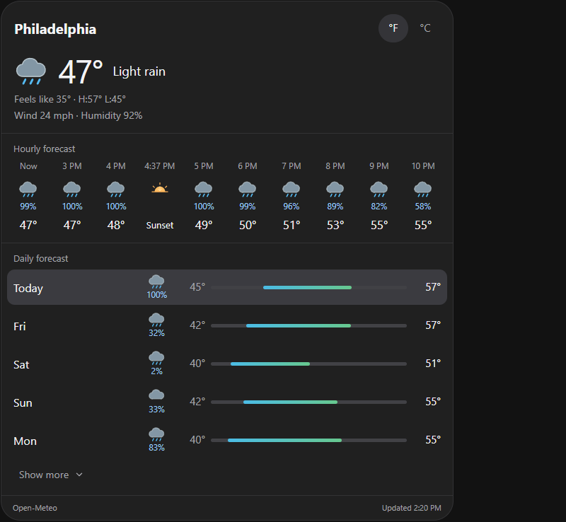

# Weather Cards



Real forecasts, readable at a glance. A portable, skill-only Hermes plugin that fetches Open-Meteo once and renders a responsive inline HTML card. No API key and no runtime dependencies beyond Python 3.10+ standard library.

This is a **skill-generated HTML component**, not a native Hermes-enforced weather tool. The skill instructs the agent to fetch and preview it; Hermes does not force every weather answer through this card.

## The card

- Bold city header with working Fahrenheit/Celsius segmented buttons.
- Current icon, temperature, condition, feels-like, high/low, wind and humidity.
- 24-hour strip with blue precipitation probabilities and sunrise/sunset at their actual chronological positions. No visible scrollbar: on desktop, round arrow buttons appear when you hover the strip; on phones you swipe it.
- Five daily rows, expandable to the fetched 10 or 14 days. Daily bars share one temperature scale across the entire forecast.
- Tap any day to see it: the top section shows that day's high, low, condition and chance of precipitation, and the strip shows that day's fetched hours with its sunrise and sunset. Tap Today to return to current conditions.
- The card draws no page background of its own, so it sits on whatever theme the chat uses. Inside a Hermes inline preview it reports its real height, so Show more and day changes never clip or leave a gap.
- Original SVG icons with clear/partly-cloudy day and night variants. No Apple artwork or Apple Weather data. Appearance intentionally differs.
- System light/dark theme, host CSS variable fallbacks, keyboard-accessible controls and 360-640px card sizing.
- Every temperature and wind value converts locally. Buttons make no network requests and need no model turn.
- Compact footer: the Open-Meteo attribution link and **Updated** with the time the forecast was fetched.

| Phone, dark | Phone, light |
| --- | --- |
|  |  |



Screenshots are actual Philadelphia Open-Meteo snapshots captured November 26, 2026, not today's guaranteed conditions. They are documentation, not a live service. Synthetic frozen test fixtures are separate in `tests/test_weather.py` and are never used for the live demo.

## Install and use

Until a maintainer merges the catalog entry, install by repository URL rather than assuming Marketplace availability:

```bash
hermes plugins install https://github.com/kenhendricks00/hermes-weather-cards
```

Follow the Hermes installer review prompts, then reload skills or start a new session if needed. Ask: "What's the weather in Philadelphia this weekend?" The skill tells the agent to fetch real data and return `::preview{file="/absolute/path/forecast.html"}`. Preview support depends on the Hermes surface. If unavailable, open the generated local HTML file.

Standalone:

```bash
python skills/weather-cards/scripts/weather_card.py   --city Philadelphia --latitude 39.97 --longitude -75.13 --days 10   --raw-output /chosen/scratch/forecast.json   --output /chosen/scratch/forecast.html
```

Replace scratch paths for your OS. Omit both coordinates to geocode. Geocoding chooses the first match; inspect `resolved_location` in the raw JSON, or use explicit coordinates for ambiguous names. `--unit C`, `--theme light`, `--theme dark`, and `--days 14` are supported. Five rows appear initially; Show more reveals the remaining fetched days.

Render a known saved response without another fetch:

```bash
python skills/weather-cards/scripts/weather_card.py   --input /chosen/scratch/forecast.json --output /chosen/scratch/offline.html
```

Saved input can be direct Open-Meteo JSON, the script's `{city, retrieved_at, forecast}` envelope, or a Printing Press `{meta, results}` envelope with the same schema. It must use numeric Unix times, C and km/h. ISO local wall times are rejected rather than guessed during DST. The existing Weather GOAT CLI can supplement alerts or advice, but is neither required nor installed by this plugin. Its output may lack hourly data or use ISO times; fetch directly with this script when a complete card is needed.

## Accuracy and time

Missing values display as a dash, never fake zero. Invalid units, mismatched arrays, non-finite values, invalid ranges and provider errors fail visibly. A failed command overwrites the chosen HTML output with an error card, returns nonzero, and never silently substitutes an older snapshot. No cache, polling or automatic refresh.

The footer's **Updated** time is when this card fetched the forecast from Open-Meteo, not the provider's model-run time (which Open-Meteo does not expose). If the card is viewed on a later day the date is added. If a saved input has no fetch time, the footer falls back to **Valid** with the provider's `current.time`. The card is a static snapshot and does not refresh. UTC epoch seconds preserve DST chronology; browser `Intl` formats in the location's IANA timezone. Selecting a day shows only fetched values for that day (daily high, low, condition, precipitation chance and the hourly rows the provider returned); nothing is estimated. Forecasts are not guarantees, real-time observations or severe-weather alerts.

## Privacy, network and provider terms

Only an explicit fetch contacts:

- `https://geocoding-api.open-meteo.com/v1/search`, if coordinates are omitted. Sends the city query and network metadata.
- `https://api.open-meteo.com/v1/forecast`. Sends coordinates, requested fields and network metadata.

Requests have a timeout and size limit, allowlisted HTTPS hosts/paths and refused redirects. The offline HTML has no third-party scripts, remote icons, telemetry or browser network fetches. Its only message is the documented Hermes inline preview size report (`hermes-inline-preview-size`) sent to the parent frame with the host's own token; outside a Hermes preview no token exists and nothing is sent. The attribution link navigates to Open-Meteo only if clicked. No shell children, credentials, cookies, token scraping, private Hermes APIs, host patching, background jobs or uploads. The Python script reads its bundled template and your explicitly selected JSON, then writes your chosen HTML and optional raw JSON. It does not read other files or profiles.

Normal no-key Open-Meteo API access is **non-commercial**, subject to [current terms and rate limits](https://open-meteo.com/en/terms), not an unlimited or free commercial-hosting promise. Commercial use or higher limits may require an [upstream paid plan](https://open-meteo.com/en/pricing); this plugin neither signs you up nor implements paid-key routing. Weather data attribution and licence: [Open-Meteo data licence](https://open-meteo.com/en/licence), [CC BY 4.0](https://creativecommons.org/licenses/by/4.0/). Geocoding data originates from GeoNames. The MIT licence covers this code and original artwork, not upstream data. Unit conversion and visual summarization modify the data presentation; no provider endorsement is implied.

## Verification

```bash
python -m unittest discover -s tests -v
hermes plugins validate .
```

CI runs offline stdlib tests on Ubuntu, macOS and Windows with Python 3.10 and 3.13. Optional browser tests use Playwright only as a development dependency and only local headless Microsoft Edge:

```bash
PYTHONPATH= uv run --no-project --with playwright python tests/browser_check.py
# Also verify a previously fetched live snapshot and capture docs screenshots:
PYTHONPATH= uv run --no-project --with playwright python tests/browser_check.py   --live /chosen/scratch/forecast.html --screenshots
```

Browser checks cover every temperature and wind conversion, Show more/less, day selection and return to Today, hover-only arrows, touch swipe with no scrollbar, row gaps, a transparent page background, inline frame sizing in a simulated Hermes preview host (grows and shrinks with Show more), common-scale bars, missing values, safe city escaping, day/night artwork, DST repeated hours, light/dark and 360/390/640/960px no-page-overflow. Browser screenshots prove standalone layout and controls, not native Hermes Desktop or iPhone delivery. Tests never claim that local fixtures are live data.

## Package

`plugin.json`, one portable `skills/weather-cards` directory, two readable runtime files (Python + HTML), tests, original artwork and docs. No runtime hooks, tools, middleware or required environment variables. Uninstall with the normal Hermes plugin manager; delete chosen output files separately if desired.
