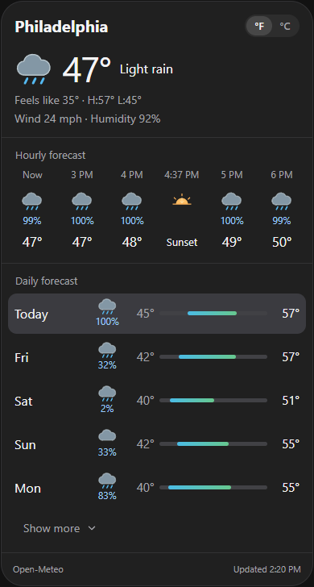
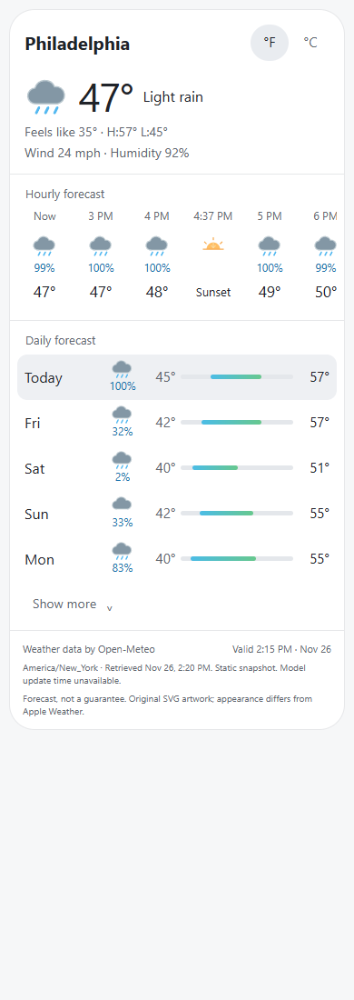

# Weather Cards for Hermes Agent


A forecast card for [Hermes Agent](https://github.com/NousResearch/hermes-agent).
When you ask about the weather, the skill tells the agent to fetch a real
forecast from Open-Meteo and show an inline card instead of a wall of text:

- city, current temperature, condition, feels-like, high/low, wind and humidity
- a 24-hour strip with precipitation chance and sunrise/sunset in their real positions
- five daily rows on one shared temperature scale, expandable to 10 or 14 days
- tap a day to see its high, low, condition and hours; tap Today to go back
- working °F/°C buttons that convert locally, with no network request or model turn

The card is a static snapshot. Its footer shows **Updated** with the time the
forecast was fetched. It draws no page background, so it sits on the chat's
light or dark theme. The icons are original SVG artwork; this is not Apple
Weather data or artwork, and the look intentionally differs.

| Phone, dark | Phone, light |
| --- | --- |
|  |  |


Screenshots are real Philadelphia Open-Meteo snapshots captured November 26,
2026, not today's conditions. The banner uses the synthetic test fixture.

This is a skill that generates HTML, not a native Hermes weather tool. Hermes
does not force every weather answer through the card.

## Install

```bash
hermes plugins install kenhendricks00/hermes-weather-cards --enable
```

A Marketplace listing is pending
([catalog PR](https://github.com/NousResearch/hermes-agent/pull/160559)). This
is a [Portable Agent Plugins v1](https://agent-plugins.org/specification)
package with one skill, `weather-cards:weather-cards`, and the script it runs. Start a new
session after installing so the skill shows up. No API key is needed, and the
script uses only the Python 3.10+ standard library.

## Usage

Ask Hermes the way you normally would:

> What's the weather in Philadelphia this weekend?

The agent fetches the forecast and renders the card:

```bash
python skills/weather-cards/scripts/weather_card.py --city Philadelphia --latitude 39.97 --longitude -75.13 --days 10 \
  --raw-output forecast.json --output forecast.html
```

and replies with one line plus

```
::preview{file="/absolute/path/forecast.html"}
```

Omit both coordinates to geocode; the first match wins, so check
`resolved_location` in the raw JSON or pass coordinates for ambiguous names.
Options: `--unit C`, `--theme light|dark`, `--days 14`. Re-render a saved
response without fetching again:

```bash
python skills/weather-cards/scripts/weather_card.py --input forecast.json --output offline.html
```

Saved input can be direct Open-Meteo JSON, the script's own envelope or a
Printing Press `{meta, results}` envelope, with numeric Unix times, °C and
km/h. ISO local times are rejected rather than guessed across DST.

Missing values show as a dash, never a fake zero. Bad units, mismatched arrays
and provider errors fail visibly: the output becomes an error card, the command
exits nonzero and no older snapshot is substituted. Forecasts are not
guarantees, live observations or severe-weather alerts.

## What this plugin does and touches

- **Network.** Only an explicit fetch contacts Open-Meteo:
  `geocoding-api.open-meteo.com/v1/search` (city name, only when coordinates
  are omitted) and `api.open-meteo.com/v1/forecast` (coordinates and fields).
  Requests use allowlisted HTTPS hosts, a timeout and a size limit, and refuse
  redirects. No cache, polling or background refresh.
- **The card.** No third-party scripts, remote icons, telemetry or network
  fetches. Its only message is the `hermes-inline-preview-size` report to the
  parent frame, sent with the host's own token so the preview fits the card;
  outside a Hermes preview nothing is sent. The attribution link opens
  Open-Meteo only if you click it.
- **Files.** The script reads its bundled template and the JSON you point it
  at, and writes the HTML and optional raw JSON you choose. No credentials,
  cookies, hooks, background jobs or uploads.
- **Provider terms.** No-key Open-Meteo access is non-commercial and subject to
  its [terms and rate limits](https://open-meteo.com/en/terms); commercial use
  may need a [paid plan](https://open-meteo.com/en/pricing), which this plugin
  does not set up. Weather data is under the
  [Open-Meteo licence](https://open-meteo.com/en/licence),
  [CC BY 4.0](https://creativecommons.org/licenses/by/4.0/). Geocoding data
  comes from GeoNames. No provider endorsement is implied.

## Develop

```bash
git clone https://github.com/kenhendricks00/hermes-weather-cards
cd hermes-weather-cards
python -m unittest discover -s tests -v
hermes plugins validate .
# Optional, local headless Edge only:
PYTHONPATH= uv run --no-project --with playwright python tests/browser_check.py
PYTHONPATH= uv run --no-project --with playwright python tests/make_assets.py
```

Unit tests use synthetic frozen fixtures and need only stdlib. Browser checks
cover unit conversion, Show more/less, day selection, hover arrows and touch
swipe, inline frame sizing in a simulated Hermes host, missing values, safe
escaping, DST repeated hours, light/dark and 360 to 960px widths. They do not
test native Hermes Desktop or iPhone delivery. `make_assets.py` rebuilds the
icon PNGs and banner.

## More cards

- [Order Cards](https://github.com/kenhendricks00/hermes-order-cards): approve a checkout before the agent pays.
- [Send Cards](https://github.com/kenhendricks00/hermes-send-cards): review message drafts before they go out.
- Weather Cards (this repo): real forecasts at a glance.
- [Input Cards](https://github.com/kenhendricks00/hermes-input-cards): hand API keys to Hermes's secure prompt.
- [Hermes Pages](https://github.com/kenhendricks00/hermes-pages-plugin): turn answers into shareable pages.
- [Places Cards](https://github.com/kenhendricks00/hermes-places-cards): nearby places with honest source data.

Each works on its own; together they bring Grok Bot style inline cards to Hermes.

## License

MIT, see [LICENSE](LICENSE). The licence covers this code and original artwork,
not upstream weather data.
